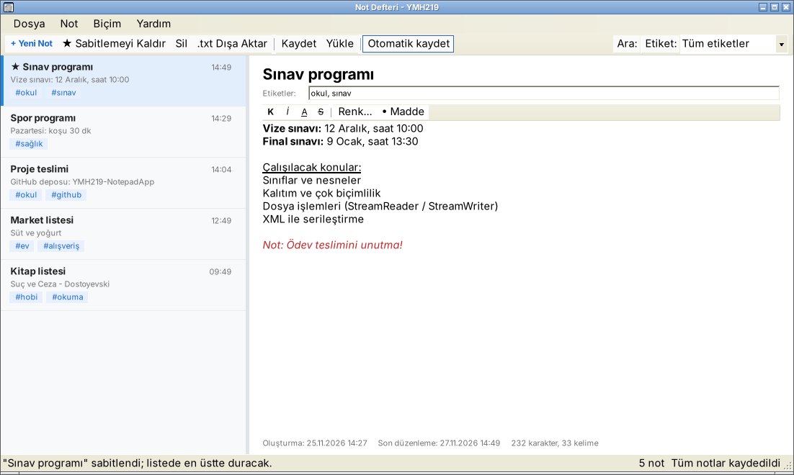
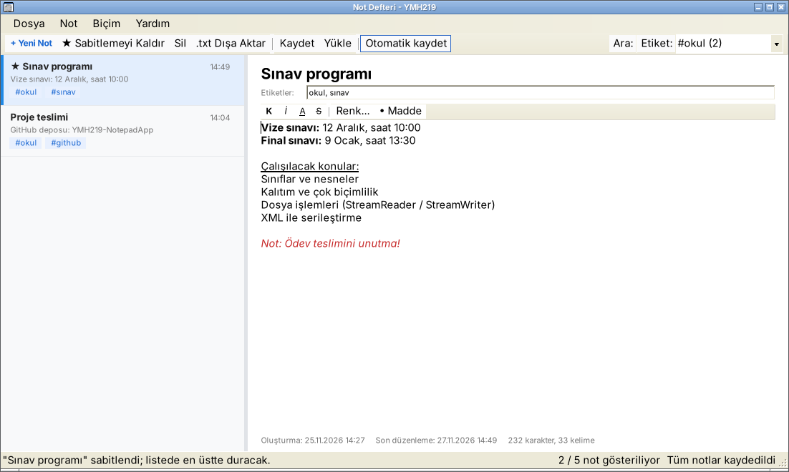

# YMH219-NotepadApp

Notları bilgisayarda kalıcı olarak saklayan bir Windows Forms not defteri. Her not başlık, biçimli içerik, etiketler ve oluşturma/düzenleme tarihleriyle tutulur; bütün notlar XML dosyasına serileştirilir ve uygulama açılırken kendiliğinden geri yüklenir.

Nesne Tabanlı Programlama (YMH 219) dersi ek uygulama ödevidir.

## Kullanılan Teknolojiler

- C# / .NET 10, Windows Forms
- `System.Xml.Serialization.XmlSerializer` ile XML serileştirme
- `System.IO` (`File`, `StreamReader`, `StreamWriter`) ile dosya işlemleri
- `List<Not>` koleksiyonu ve LINQ ile arama, sıralama ve etiket sayımı
- `RichTextBox` ile biçimli metin (RTF), sahibi tarafından çizilen (owner-draw) `ListBox` ile kart görünümü
- Harici NuGet paketi kullanılmamıştır.

## Kurulum ve Çalıştırma

1. Depoyu klonlayın:
   ```bash
   git clone https://github.com/KULLANICI_ADI/YMH219-NotepadApp.git
   ```
2. `YMH219-NotepadApp.sln` dosyasını Visual Studio ile açın.
3. **F5** ile çalıştırın.

Gereksinimler: Windows ve Visual Studio 2022 veya üstü (".NET masaüstü geliştirme" iş yükü, .NET 10 SDK).

## Kullanım

- **+ Yeni Not** (Ctrl+N) listeye boş bir not ekler ve düzenleyicide açar. Başlığı, etiketleri ve içeriği yazmanız yeterlidir; yazmaya ara verdiğinizde değişiklikler nota işlenir ve düzenleme tarihi güncellenir.
- Soldaki listeden bir nota tıklayınca not düzenleyicide açılır. Hiçbir şey yazılmadan bırakılan boş notlar kendiliğinden silinir.
- **Sil** notu onay sorduktan sonra siler. Listede sağ tıklayınca da sabitleme, dışa aktarma ve silme seçenekleri çıkar.
- **★ Sabitle** notu listenin en üstüne sabitler.
- **.txt Dışa Aktar** (Ctrl+E) açık notu düz metin dosyası olarak kaydeder.
- **Ara** kutusu başlıkta, içerikte ve etiketlerde arar; **Etiket** kutusu yalnızca seçilen etiketi taşıyan notları gösterir.
- **Kaydet** (Ctrl+S) bütün notları dosyaya yazar, **Yükle** (Ctrl+O) dosyadan yeniden okur.
- **Otomatik kaydet** açıkken her değişiklikten sonra notlar dosyaya kendiliğinden yazılır.
- Biçim çubuğu ve **Biçim** menüsü: kalın (Ctrl+B), italik (Ctrl+I), altı çizili (Ctrl+U), üstü çizili, yazı rengi ve madde işareti.

## Özellikler

**Asgari gereksinimler**

- Başlık ve içerikten oluşan not ekleme, listeleme, düzenleme ve silme.
- Notlar XML dosyasına serileştirilerek kaydedilir; uygulama açılırken otomatik olarak geri yüklenir.
- Açık not düz metin (`.txt`) olarak dışa aktarılabilir.
- Kaydet ve Yükle işlemleri; dosya bulunamadığında, bozuk olduğunda veya yazılamadığında hata yönetimi.
- Notlar `Not` sınıfı ve `List<Not>` koleksiyonu ile yönetilir.
- Her notun oluşturma ve son düzenleme tarihi tutulur ve düzenleyicinin altında gösterilir.

**İsteğe bağlı geliştirmeler**

- Başlık, içerik ve etiketlerde arama (büyük/küçük harf ayrımı yapılmaz) ve etikete göre filtreleme.
- Her işlemden sonra otomatik kaydetme (açılıp kapatılabilir).
- Etiket desteği: her nota birden fazla etiket, etiket başına not sayısı.
- `RichTextBox` ile kalın, italik, altı/üstü çizili, renkli metin ve madde işaretleri; biçimler dosyada saklanır.

**Ek ayrıntılar**

- Notlar listede kart olarak görünür: başlık, düzenleme zamanı, içeriğin ilk satırı ve etiketler.
- Not sabitleme; sabit notlar her zaman en üstte.
- Düzenleyicinin altında karakter ve kelime sayısı.

## Notların Saklandığı Dosya

```
%AppData%\YMH219-NotepadApp\notlar.xml
```

Örnek içerik:

```xml
<?xml version="1.0" encoding="utf-8"?>
<NotDefteri surum="1">
  <KayitZamani>2026-11-27T14:49:12.5+03:00</KayitZamani>
  <Notlar>
    <Not>
      <Id>3f2c9a8e-1b7d-4c55-9a0e-6d1f2b3c4d5e</Id>
      <Baslik>Sınav programı</Baslik>
      <Icerik>Vize sınavı: 12 Aralık ...</Icerik>
      <BicimliIcerik>{\rtf1\ansi ...}</BicimliIcerik>
      <Etiketler>
        <Etiket>okul</Etiket>
        <Etiket>sınav</Etiket>
      </Etiketler>
      <Sabitlendi>true</Sabitlendi>
      <OlusturmaTarihi>2026-11-25T14:27:00+03:00</OlusturmaTarihi>
      <DuzenlemeTarihi>2026-11-27T14:49:00+03:00</DuzenlemeTarihi>
    </Not>
  </Notlar>
</NotDefteri>
```

`Icerik` notun düz metnidir (arama ve `.txt` için), `BicimliIcerik` aynı içeriğin biçimleri de taşıyan RTF hâlidir. Başlığı ve içeriği boş olan notlar dosyaya yazılmaz.

## Hata Yönetimi

| Durum | Uygulamanın davranışı |
|---|---|
| Dosya yok (ilk çalıştırma) | Boş listeyle açılır, durum çubuğunda bilgi verir; ilk kayıtta dosya oluşturulur |
| **Yükle** seçildiğinde dosya bulunamıyor | Uyarı gösterilir, ekrandaki notlar korunur; **Kaydet** dosyayı yeniden oluşturur |
| Dosya bozuk veya not defteri XML'i değil | Hata gösterilir; bozuk dosya silinmez, `notlar.bozuk-<tarih>.xml` adıyla saklanır |
| Dosya okunamıyor (izin, kilit) | Hata gösterilir, üzerine yazılmasın diye otomatik kayıt kapatılır |
| Dosya yazılamıyor | Hata bir kez gösterilir, otomatik kayıt kapatılır; notlar bellekte kalır |
| Dosyada eksik alanlar | Eksik alanlar varsayılan değerlerle tamamlanır, bilinmeyen alanlar yok sayılır |
| Kaydedilmemiş değişiklikle çıkış | Kaydetmek isteyip istemediğiniz sorulur |

## Sınıf Yapısı

| Sınıf | Görevi |
|---|---|
| `Not` | Not modeli: başlık, düz ve biçimli içerik, etiketler, sabitleme, tarihler |
| `NotArsivi` | XML dosyasının kök elemanı (`<NotDefteri>`): sürüm, kayıt zamanı ve not listesi |
| `INotDeposu` | Kaydetme/yükleme arayüzü |
| `XmlNotDeposu` | `INotDeposu`'nun XmlSerializer ile yazılmış hâli; bozuk dosyayı kenara alır |
| `NotDosyasiBozukException` | Dosya okunamadığında fırlatılan özel istisna |
| `NotYoneticisi` | `List<Not>` üzerinde ekleme, güncelleme, silme, sabitleme, arama ve etiket sayımı |
| `EtiketYardimcisi` | "okul, sınav; #ödev" gibi metni etiket listesine çevirir |
| `MetinDisaAktarici` | Notu `.txt` dosyasına yazar |
| `NotListesi` | Notları kart görünümünde çizen özel `ListBox` |
| `NotDefteriFormu` | Ana pencere: menü, araç çubukları, liste, düzenleyici ve geri bildirimler |

## Ekran Görüntüleri





## Bilinen Sınırlamalar ve Geliştirme Notları

- Bütün notlar tek bir XML dosyasında tutulur ve her kayıtta dosyanın tamamı yeniden yazılır; çok sayıda not için veritabanı daha uygun olur.
- Silinen not geri alınamaz.
- `.txt` dışa aktarmada biçimler (kalın, renk vb.) korunmaz.
- Uygulama aynı anda iki kez açılırsa son kaydeden pencere diğerinin değişikliklerinin üzerine yazar.
- "Otomatik kaydet" ayarı saklanmaz; uygulama her açılışta bu ayar açık olarak başlar.

